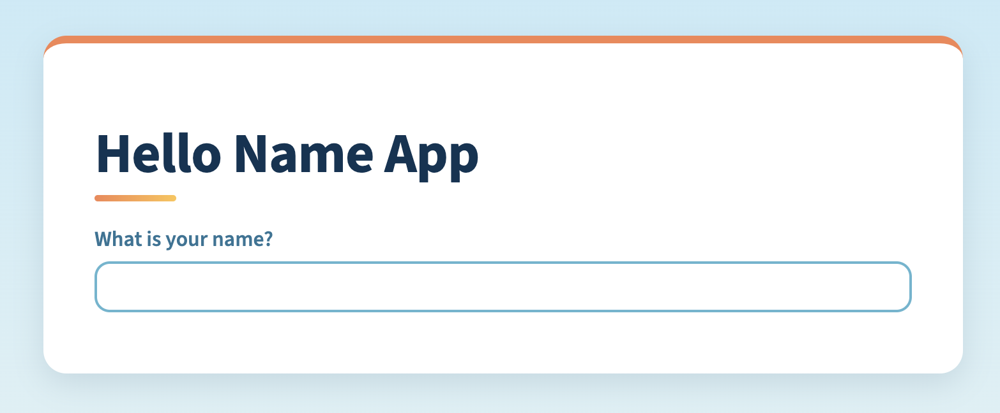
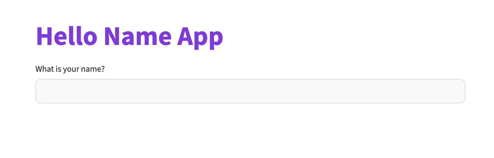

# Hello Name App

A small, friendly Streamlit app that asks for your name and says hello back. It was built as an introduction to Streamlit and to styling a Streamlit app with your own CSS.

**Live app:** [https://se26-app-intro-m6bj6jskk9v7yu2ufih7gb.streamlit.app/](https://se26-app-intro-m6bj6jskk9v7yu2ufih7gb.streamlit.app/)

This README has two parts. The user documentation explains how to use the app and needs no technical knowledge. The technical documentation explains how the app is built, how to run it on your own computer, and how CSS works inside Streamlit.

---

## User Documentation

### What the app does

The Hello Name App is a simple greeting app. You type your name into a box and the app replies with a personal hello message. Nothing you type is saved or sent anywhere else; the greeting only appears on your screen.

### Opening the app

You do not need to install anything. Open the live link in any modern web browser, on a computer, tablet or phone:

[https://se26-app-intro-m6bj6jskk9v7yu2ufih7gb.streamlit.app/](https://se26-app-intro-m6bj6jskk9v7yu2ufih7gb.streamlit.app/)

If the app has not been used for a while, Streamlit may show a message saying the app is asleep. Click the button to wake it up and wait a few seconds for it to load.

### What you will see

When the app opens you will see the title "Hello Name App" at the top, and underneath it a question, "What is your name?", with an empty text box. Figure 1 below shows the app as it looks when you first open it.



*Figure 1: The Hello Name App when it first opens, ready for you to type your name.*

### Using the app

Click inside the text box and type your name. When you have finished, press **Enter** on your keyboard, or simply click somewhere else on the page. A green greeting card appears underneath the box with a message such as "Hello, Katia!". Figure 2 below shows the greeting after the name "Garfield" has been entered.



*Figure 2: The greeting card that appears after you enter your name.*

To change the name, click back into the box, edit or replace what is there, and press Enter again. The greeting updates straight away. If you delete everything in the box, the greeting disappears.

### Troubleshooting

If the greeting does not appear, make sure you pressed Enter or clicked outside the box, because the app waits until you have finished typing. If the page looks blank or stuck, refresh your browser. If the live link does not load at all, the hosted app may be temporarily unavailable; try again a little later.

---

## Technical Documentation

### Overview

The app is written in Python using [Streamlit](https://streamlit.io/), a library that turns a Python script into an interactive web page without needing to write any HTML or JavaScript. It is deployed on Streamlit Community Cloud, which hosts the live version linked above.

### Project structure

The project is deliberately small. `app.py` is the Streamlit app itself. `style.css` holds the custom styles that change the look of the app. The `assets` folder contains the screenshot used in this README. `LICENSE` is the MIT licence, and `.gitignore` stops files such as the virtual environment and Streamlit secrets from being committed.

### How the app works

Streamlit runs your Python script from top to bottom every time the user interacts with the page. That simple idea explains the whole app.

```python
from pathlib import Path  # Builds the path to the style.css file
import streamlit as st  # Streamlit turns this script into a web app

st.html(Path("style.css"))

st.title("Hello Name App")

user_name = st.text_input("What is your name?")

if user_name:
    with st.container(key="greeting"):
        st.write(f"Hello, { user_name }!")
```

The first `st.html` line loads the CSS file into the page (more on this below). `st.title` draws the big heading. `st.text_input` draws the text box and returns whatever the user has typed, or an empty string if they have typed nothing. When the user presses Enter, Streamlit re-runs the script, so `user_name` now holds their name. The `if` check is then true and the greeting is written inside a container. The container is given the key `greeting`, which is what lets us style it with CSS.

### Running the app locally

You will need Python 3.9 or newer. Open a terminal in the project folder, then run the commands below one at a time. Each command is in its own box so you can copy it with the copy button.

#### macOS (Terminal)

1. Create a virtual environment:

   ```bash
   python3 -m venv .venv
   ```

2. Activate it. Your prompt will start with `(.venv)`:

   ```bash
   source .venv/bin/activate
   ```

3. Install Streamlit:

   ```bash
   pip install streamlit
   ```

4. Start the app:

   ```bash
   streamlit run app.py
   ```

#### Windows (PowerShell)

1. Create a virtual environment:

   ```powershell
   py -m venv .venv
   ```

2. Activate it. Your prompt will start with `(.venv)`:

   ```powershell
   .venv\Scripts\Activate.ps1
   ```

   If PowerShell says running scripts is disabled, run this once, then try step 2 again:

   ```powershell
   Set-ExecutionPolicy -Scope CurrentUser -ExecutionPolicy RemoteSigned
   ```

   If you are using Command Prompt instead of PowerShell, activate with:

   ```bat
   .venv\Scripts\activate.bat
   ```

3. Install Streamlit:

   ```powershell
   pip install streamlit
   ```

4. Start the app:

   ```powershell
   streamlit run app.py
   ```

#### After it starts

Streamlit will print a local address, usually `http://localhost:8501`, and open it in your browser. To stop the app, press **Ctrl + C** in the terminal. Next time, you only need to activate the virtual environment (step 2) and start the app (step 4).

While the app is running, save your changes to `app.py` or `style.css`, click on the page and press **R** to rerun it. The app hides Streamlit's usual top bar, so the "Rerun" menu is not shown.

The project was developed with Streamlit 1.67. Loading a CSS file with `st.html` and styling containers by key both need a fairly recent version, so if the styles do not appear, upgrade Streamlit (on macOS or Windows) with the virtual environment active:

```bash
pip install --upgrade streamlit
```

### Deploying

The live app is hosted on Streamlit Community Cloud. To deploy your own copy, push the repository to GitHub, sign in at [share.streamlit.io](https://share.streamlit.io/) with your GitHub account, choose "Create app", and point it at this repository with `app.py` as the main file. Community Cloud installs Streamlit automatically. If you later add other libraries, list them in a `requirements.txt` file so the cloud server knows to install them too.

---

## Using CSS in Streamlit

Streamlit gives every app a clean default look, but sometimes you want your own colours, spacing or fonts. Streamlit does not have a built-in setting for every visual detail, so the common approach is to write ordinary CSS and inject it into the page.

### Loading the CSS file

In recent versions of Streamlit, `st.html` can be given the path to a `.css` file. Streamlit reads the file and adds its contents to the page inside a `<style>` tag, so the rules apply to the whole app.

```python
from pathlib import Path  # Builds the path to the style.css file
st.html(Path("style.css"))
```

Keeping the CSS in its own file, rather than in a long string inside `app.py`, keeps the Python code readable and means your editor can highlight and check the CSS properly.

You may also see older tutorials that do this instead:

```python
st.markdown("<style> h1 { color: navy; } </style>", unsafe_allow_html=True)
```

That still works, but `st.html` with a file is the tidier, modern option.

### Choosing the right selectors

This is the most important part of styling Streamlit. If you right-click the page and choose "Inspect", you will see class names like `st-emotion-cache-15ialw`. It is tempting to copy these into your CSS, and the very first version of this project did exactly that. The problem is that these names are generated automatically and can change whenever Streamlit is updated, at which point your styles silently stop working.

Instead, this project uses two kinds of selector that Streamlit keeps stable.

The first is the `data-testid` attribute. Most Streamlit elements carry one, for example `stApp` for the whole page, `stMainBlockContainer` for the central content area, `stHeading` for titles, `stWidgetLabel` for input labels and `stTextInputRootElement` for the text box. You select them with square brackets:

```css
[data-testid="stHeading"] h1 {
    color: var(--navy);
}
```

The second is the key class. When you give a container (or most widgets) a `key`, Streamlit adds a CSS class called `st-key-` followed by that key. That is how the greeting card is styled:

```python
with st.container(key="greeting"):
    st.write("Hello!")
```

```css
.st-key-greeting {
    background: var(--mint-light);
    border-left: 6px solid var(--sage);
    border-radius: 12px;
}
```

Keys are the best way to style one specific part of your app without affecting everything else, because you choose the name yourself.

### The colour palette

All the colours live in one place at the top of `style.css`, as CSS custom properties (variables) on `:root`. The rest of the file refers to them with `var(--name)`. To re-theme the app you only need to change these values.

```css
:root {
    --orange: #f58552;
    --sun: #fec54c;
    --mint-light: #bfe2c6;
    --sage: #609f80;
    --forest: #045944;
    --sky-light: #c8eaf7;
    --sky: #62b6d0;
    --ocean: #2d7496;
    --navy: #0d3353;
}
```

The palette is built from four families: warm oranges (`#faae80` to `#d74b19`), sunny yellows (`#ffe1a5` to `#e2a854`), calm greens (`#bfe2c6` to `#1b4538`) and blues (`#c8eaf7` to `#0d3353`). The page background fades from light sky blue to cream. The content sits on a white card with an orange stripe across the top. The title is dark navy with a short orange-to-yellow underline. The label is ocean blue, the text box has a sky-blue border that turns orange while you type, and the greeting appears in a soft mint card with dark green text. Dark text on light backgrounds keeps everything easy to read.

### Tips for your own styling

Make one change at a time and rerun the app to see its effect, so it is clear which rule did what. Use the browser's Inspect tool to find the `data-testid` of the element you want to change. If a rule does not seem to apply, Streamlit's own styles may be more specific than yours; making your selector more specific (for example `[data-testid="stHeading"] h1` rather than just `h1`) usually fixes it, and `!important` is a last resort. Finally, for simple app-wide changes such as the main accent colour or font, Streamlit also offers theming through a `.streamlit/config.toml` file, which is worth trying before writing CSS.

---

## Licence

This project is released under the MIT Licence. See [LICENSE](LICENSE) for details.
